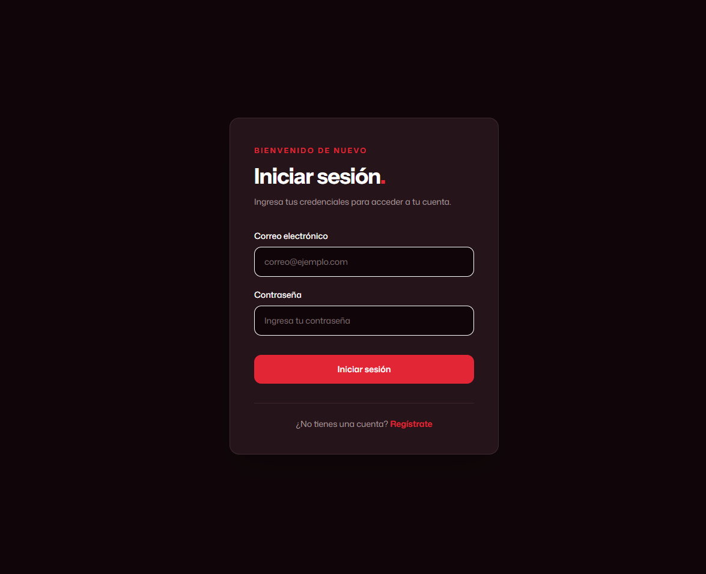
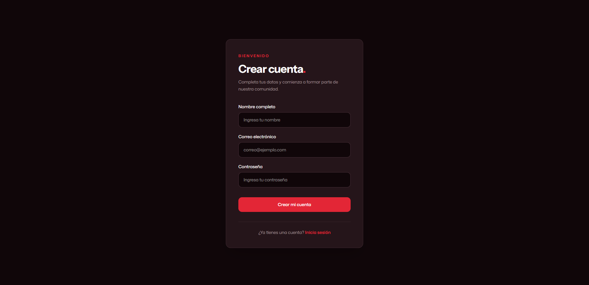
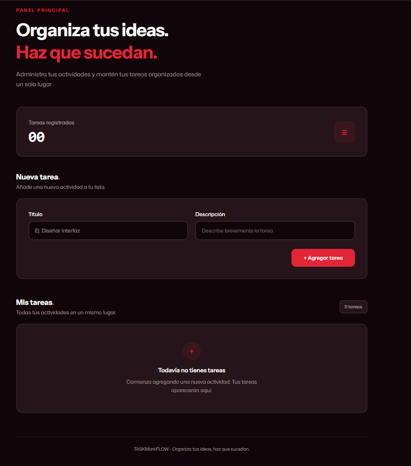
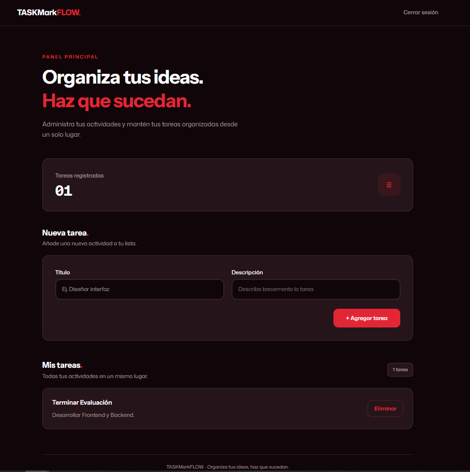

# TASKMarkFLOW

Aplicación web Full-Stack para la gestión de tareas, desarrollada como parte del Producto Académico N.º 3 (PA3).

TASKMarkFLOW permite a los usuarios registrarse, iniciar sesión y administrar sus propias tareas mediante una interfaz web conectada a una API REST.

## 1. Tecnologías utilizadas

### Frontend
- React 19
- TypeScript
- Vite
- Tailwind CSS 4
- React Router

### Backend
- Node.js
- Express 5
- TypeScript
- MongoDB
- Mongoose
- JSON Web Token (JWT)
- bcryptjs
- dotenv
- CORS

## 2. Funcionalidades principales

- Registro de nuevos usuarios.
- Inicio de sesión mediante correo electrónico y contraseña.
- Encriptación de contraseñas utilizando bcryptjs.
- Autenticación mediante tokens JWT.
- Protección de rutas privadas.
- Visualización de las tareas del usuario autenticado.
- Creación de nuevas tareas.
- Eliminación de tareas.
- Almacenamiento de usuarios y tareas en MongoDB.
- Asociación de las tareas con el usuario correspondiente.

## 3. Estructura del proyecto

El repositorio está organizado de la siguiente manera:

```text
pa3-fullstack-marco/
│
├── client/
│   ├── src/
│   ├── public/
│   ├── package.json
│   └── ...
│
├── server/
│   ├── src/
│   │   ├── config/
│   │   ├── controllers/
│   │   ├── middlewares/
│   │   ├── models/
│   │   ├── routes/
│   │   └── index.ts
│   │
│   ├── .env.example
│   ├── package.json
│   └── ...
│
├── .gitignore
└── README.md
```

## 4. Requisitos previos

Antes de ejecutar el proyecto, es necesario contar con:

- Node.js (versión LTS recomendada).
- npm (incluido con Node.js).
- MongoDB instalado localmente o una cuenta en MongoDB Atlas.
- Git (para clonar el repositorio).

## 5. Instalación y configuración

### 5.1. Clonar el repositorio

```bash
git clone URL_DEL_REPOSITORIO
```

Ingresar a la carpeta del proyecto:

```bash
cd pa3-fullstack-marco
```

### 5.2. Configurar el backend

Ingresar a la carpeta del servidor:

```bash
cd server
```

Instalar las dependencias:

```bash
npm install
```

Crear un archivo `.env` tomando como referencia el archivo `.env.example`.

El archivo `.env` debe contener las siguientes variables:

```env
PORT=5000
MONGO_URI=mongodb://localhost:27017/pa3_tareas
JWT_SECRET=tu_clave_secreta_aqui
```

**Importante:** Si se utiliza MongoDB Atlas, se debe reemplazar el valor de `MONGO_URI` por la cadena de conexión proporcionada por la plataforma.

También se debe reemplazar `JWT_SECRET` por una clave secreta propia y segura.

El archivo `.env` contiene información privada y no debe subirse al repositorio.

### 5.3. Configurar el frontend

Abrir una segunda terminal desde la carpeta raíz del proyecto e ingresar a `client`:

```bash
cd client
```

Instalar las dependencias:

```bash
npm install
```

## 6. Ejecución del proyecto

Para ejecutar la aplicación, se necesitan dos terminales abiertas desde la carpeta raíz del proyecto.

### Terminal 1: Backend

```bash
cd server
npm run dev
```

El servidor estará disponible en:

```text
http://localhost:5000
```

### Terminal 2: Frontend

```bash
cd client
npm run dev
```

Vite mostrará en la terminal la dirección local donde se puede acceder a la aplicación.

## 7. Compilación para producción

### Backend

Desde la carpeta `server`, ejecutar:

```bash
npm run build
```

Este comando compila el código TypeScript y genera los archivos JavaScript dentro de `dist/`.

Para iniciar el servidor utilizando los archivos compilados:

```bash
npm start
```

### Frontend

Desde la carpeta `client`, ejecutar:

```bash
npm run build
```

Este comando genera la versión optimizada de la aplicación dentro de `dist/`.

## 8. Endpoints de la API

La API REST utiliza las siguientes rutas:

| Método | Endpoint | Descripción | Autenticación |
|---|---|---|---|
| POST | `/api/auth/register` | Registrar un usuario | No |
| POST | `/api/auth/login` | Iniciar sesión | No |
| GET | `/api/tasks` | Obtener las tareas del usuario | Sí |
| POST | `/api/tasks` | Crear una tarea | Sí |
| DELETE | `/api/tasks/:id` | Eliminar una tarea | Sí |

Las rutas de tareas requieren un token JWT válido enviado mediante el encabezado:

```text
Authorization: Bearer <token>
```

## 9. Seguridad y autenticación

El proyecto implementa mecanismos básicos de seguridad:

- Las contraseñas se almacenan mediante hashes generados con bcryptjs y un factor de trabajo de 10 rondas.
- La autenticación utiliza JSON Web Tokens (JWT).
- Los tokens tienen una duración de 2 horas.
- Las rutas de tareas están protegidas mediante un middleware de autenticación.
- Las variables de entorno permiten mantener separadas las configuraciones privadas del código fuente.
- Las tareas se gestionan asociadas al usuario autenticado.

## 10. Capturas de pantalla

### Inicio de sesión



### Registro de usuario



### Dashboard



### Dashboard con tareas registradas



## 11. Autor

Desarrollado como parte del Prueba Académico N.º 3 (PA3).

## 12. Repositorio

[Ver repositorio en GitHub](URL_DEL_REPOSITORIO)